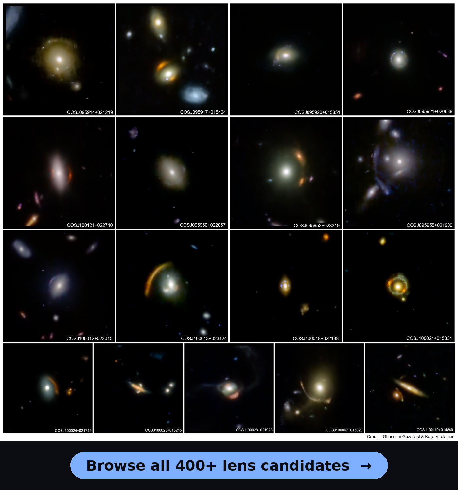

# The COSMOS-Web Lens Survey (COWLS)

[](https://jamesnightingale.net/COWLS_COSMOS_Web_Lens_Survey/)

[](https://jamesnightingale.net/COWLS_COSMOS_Web_Lens_Survey/)

<p align="center"><a href="https://jamesnightingale.net/COWLS_COSMOS_Web_Lens_Survey/"><em>Click the image to browse every lens candidate on the website →</em></a></p>

COWLS is a catalogue of over 400 strong-lens candidates found in JWST imaging of the COSMOS field, including 17 spectacular confirmed lenses. Every candidate has four-band NIRCam images plus archival HST and ground-based data, and most have a lens model made with [PyAutoLens](https://github.com/Jammy2211/PyAutoLens).

## Getting started

The easiest way in is the **[website](https://jamesnightingale.net/COWLS_COSMOS_Web_Lens_Survey/)**: click any lens to see its images and lens model, and download its `.fits` files. The **[About the data](https://jamesnightingale.net/COWLS_COSMOS_Web_Lens_Survey/about.html)** page explains the tiers, the catalogue columns and every file in a lens folder.

In this repository the lenses sit in tier folders. `M25` holds the 17 lenses of COWLS II, and `S12` down to `S00` hold the other candidates, from very high to very low quality. COWLS III predicts that about 100 of the candidates are real lenses, so think about how your analysis can confirm one.

If you're using COWLS data in your research, please get in touch with the COSMOS-Web Lensing Science Working Group so we can avoid duplicated work.

## Papers

- **COWLS I:** Nightingale et al. 2025, MNRAS ([arXiv](https://arxiv.org/abs/2503.08777), [DOI](https://doi.org/10.1093/mnras/staf1253))
- **COWLS II:** Mahler et al. 2025, MNRAS Letters ([arXiv](https://arxiv.org/abs/2503.08782), [DOI](https://doi.org/10.1093/mnrasl/slaf088))
- **COWLS III:** Hogg et al. 2025, MNRAS ([arXiv](https://arxiv.org/abs/2503.08785), [DOI](https://doi.org/10.1093/mnras/staf1678))

Every other paper that uses COWLS lenses is on the [Papers page](https://jamesnightingale.net/COWLS_COSMOS_Web_Lens_Survey/papers.html).

## Citation

Please cite the three COWLS papers above. The BibTeX entries are in [CITATIONS.bib](CITATIONS.bib).

## License

MIT; see [LICENSE](LICENSE).

<details><summary>Maintaining the website</summary>

The website is a static site in `docs/`, deployed to GitHub Pages by `.github/workflows/pages.yml`. Its lens data, `docs/data/lenses.json`, is generated from `catalogue.csv`, each lens's `info.json` and `result.json`, and the list of files tracked in git (so the large image and `.fits` files need not be downloaded). Regenerate it after the data changes with:

```bash
python scripts/build_site_data.py
```

The Papers page reads `docs/data/papers.json`, which is edited by hand.

After cloning, `python make_rgb_summary.py` collects the RGB + modeling summary image of every lens into `images/rgb_summary` (lenses without a model fall back to their `6_rgb.png`).

</details>
